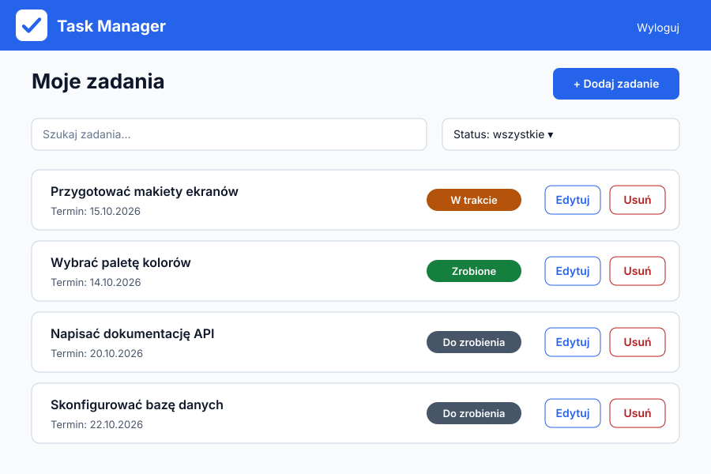
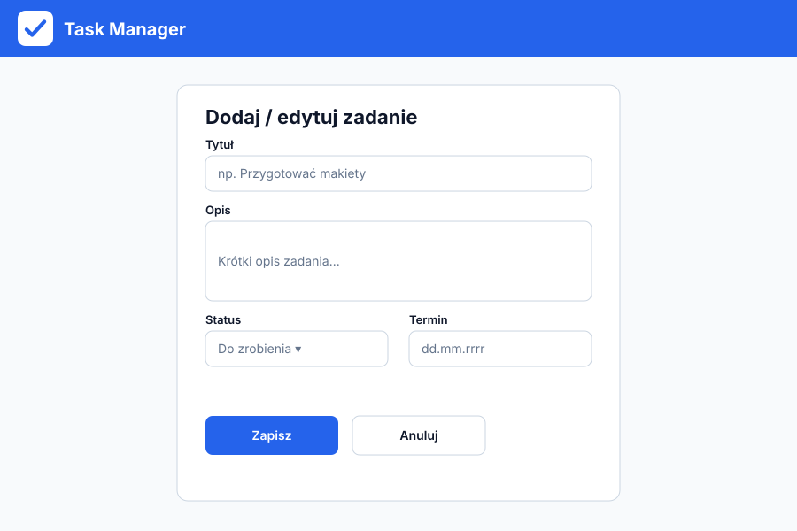
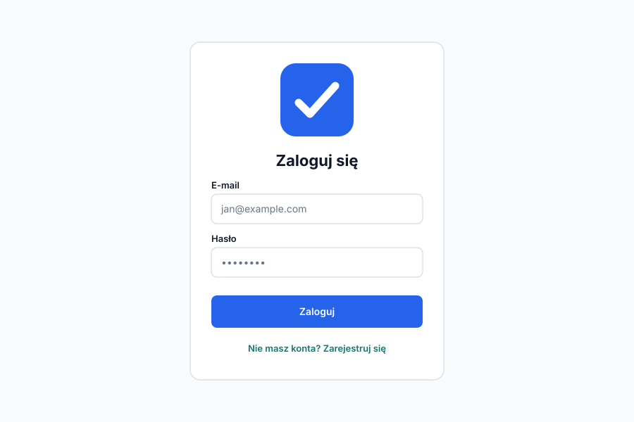

# Projekt wizualny aplikacji Task Manager

Dokument opisuje wygląd aplikacji: makiety ekranów, paletę kolorów, czcionki i logo.

## Logo


Logo to niebieski kwadrat z zaokrąglonymi rogami i białym znakiem ✓ („zadanie wykonane"). Mały zielonkawy pasek obok znaku przypomina pozycję na liście. Znak jest prosty, więc dobrze wygląda zarówno duży, jak i jako mała ikona w karcie przeglądarki.

## Makiety ekranów

### Lista zadań



Na górze jest pasek z logo i przyciskiem wylogowania. Pod nim nagłówek, przycisk dodawania, wyszukiwarka i filtr statusu. Każde zadanie to osobna karta z terminem, kolorową etykietą statusu oraz przyciskami edycji i usuwania.

### Formularz dodawania i edycji zadania



Jeden formularz służy do dodawania i edycji. Pola: tytuł, opis, status i termin. Na dole jest główny przycisk „Zapisz" i drugorzędny „Anuluj".

### Ekran logowania



Prosta karta na środku ekranu z logo, polami e-mail i hasło, przyciskiem „Zaloguj" oraz linkiem do rejestracji.

## Paleta kolorów

| Rola | Kolor | Kod HEX | Zastosowanie |
|---|---|---|---|
| Główny | niebieski | `#2563EB` | pasek górny, główne przyciski, linki |
| Dodatkowy | morski (teal) | `#0F766E` | akcenty, linki pomocnicze |
| Tło | bardzo jasny szary | `#F8FAFC` | tło strony |
| Tekst | granat/czerń | `#0F172A` | nagłówki i treść |

Kolory statusów zadań:

| Status | Kod HEX |
|---|---|
| Do zrobienia | `#475569` |
| W trakcie | `#B45309` |
| Zrobione | `#15803D` |

### Kontrast (WCAG)

Kontrast sprawdzony według wzoru z WCAG (to samo liczy webaim.org/resources/contrastchecker). Wymagane minimum dla zwykłego tekstu to 4,5:1.

| Tekst | Tło | Kontrast | Ocena |
|---|---|---|---|
| `#0F172A` | `#F8FAFC` | 17,06:1 | AAA |
| `#0F172A` | `#FFFFFF` | 17,85:1 | AAA |
| `#FFFFFF` | `#2563EB` | 5,17:1 | AA |
| `#FFFFFF` | `#0F766E` | 5,47:1 | AA |
| `#2563EB` | `#F8FAFC` | 4,94:1 | AA |
| `#FFFFFF` | `#475569` | 7,58:1 | AAA |
| `#FFFFFF` | `#B45309` | 5,02:1 | AA |
| `#FFFFFF` | `#15803D` | 5,02:1 | AA |

Wszystkie zestawienia spełniają minimum, więc tekst jest czytelny.

## Czcionki

| Element | Czcionka | Źródło |
|---|---|---|
| Nagłówki | Poppins (700) | Google Fonts |
| Treść | Inter (400, 600) | Google Fonts |

**Dlaczego Poppins w nagłówkach:** jest geometryczna i wyrazista, dzięki czemu tytuły i logo są od razu widoczne, a styl jest nowoczesny.

**Dlaczego Inter w treści:** została zaprojektowana do czytania na ekranie. Ma wyraźne, dobrze rozróżnialne litery (także małe rozmiary) i obsługuje polskie znaki.

Obie czcionki są darmowe, a na wypadek problemów z ładowaniem w CSS można dodać zapasowe `Arial, sans-serif`.

```css
@import url('https://fonts.googleapis.com/css2?family=Inter:wght@400;600&family=Poppins:wght@700&display=swap');

body { font-family: 'Inter', Arial, sans-serif; }
h1, h2, h3 { font-family: 'Poppins', Arial, sans-serif; }
```
